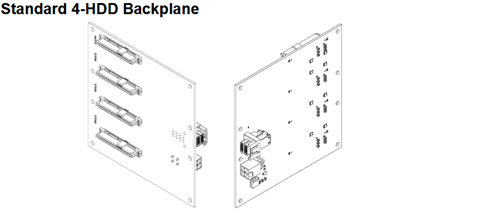
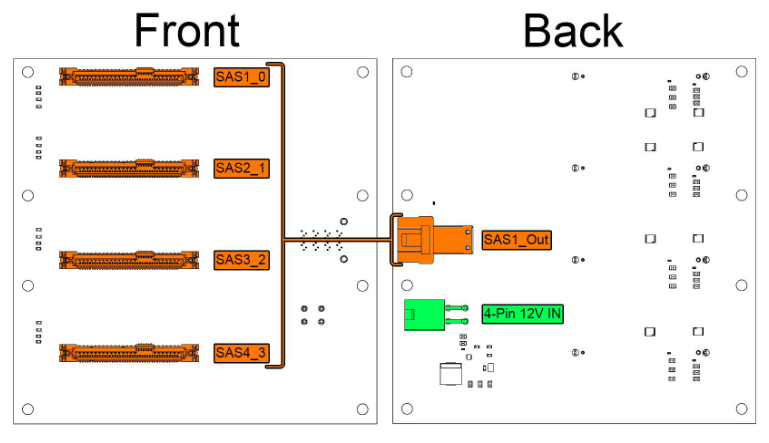

# 4-HDD Backplane

## Overview

The Standard 4-HDD Backplane provides power and data connectivity for up to four 3.5" hard disk drives or large-capacity SSDs, with integrated power regulation and SAS connectivity.

This backplane is optimized for traditional 3.5" hard disk drives, providing the higher power requirements and robust connectivity needed for spinning disk storage systems.

### Key Features

- 4 SATA/SAS 3.5" drive connectors for traditional hard drives
- Integrated 5V power regulation from 12V input
- Single SAS output connector for HBA connectivity
- Hot-swap capability with proper drive cages
- LED activity indicators for each drive bay

## Technical Specifications

| Parameter | Specification |
|-----------|---------------|
| **Drive Connectors** | 4 x SATA/SAS 3.5" |
| **SAS Output** | 1 SAS Out Connector  |
| **Input Voltage** | 12V DC |
| **Output Voltages** | 12V pass-through, 5V regulated (5A Max) |
| **Max Power Consumption** | 53 Watts |
| **Hot-Swap** | Yes |

!!! info "Power Rating & Drive Spin-Up"
    The **53 W** figure above is a conservative steady-state rating for normal operation. The backplane is built to tolerate the much higher transient inrush of hard drives spinning up — the hardware can handle peaks of up to **264 W**.

    The current revision does **not** use staggered spin-up or active inrush limiting; it relies on drives that support **Power-Up In Standby (PUIS)**. For large SATA arrays (for example, a fully populated chassis of 3.5" drives), enabling PUIS is recommended so the drives don't all spin up the instant power is applied — drives such as the Seagate Exos series support it. If you use older drives that do not support PUIS, the backplanes and power board are still built with components rated to handle the high inrush current.

    The backplane powers only the **12V and 5V** rails — **pin 3 (3.3V / PWDIS) is not powered** — so drives that use the PWDIS feature spin up normally.

## Backplane Diagram

### Status Indicators

Each drive bay includes: 
- Power LED Green when drive is powered 
- Activity LED Flashing during I/O operations 

!!! info "Power LED Compatibility"
    Some drives do not trigger the LEDs but are functioning correctly.

## Installation Guide

For PCB and Backplane Installation see [PCB Installation](../hardware/pcb-installation.md) 
For Drive Cage Installation see [Cage Installation](../hardware/cage-installation.md)

## Drive Installation

1. Insert drives gently into drive cages.
3. Gently press drive down until firmly seated.
4. Verify with LED indicators after system power-on.