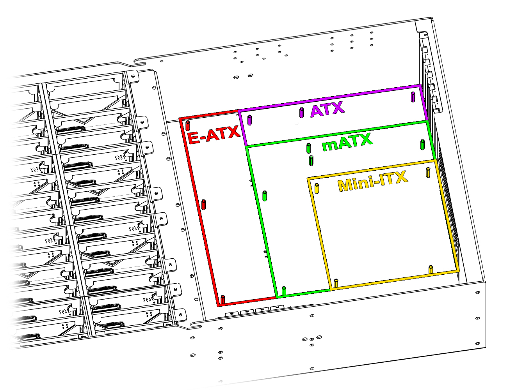
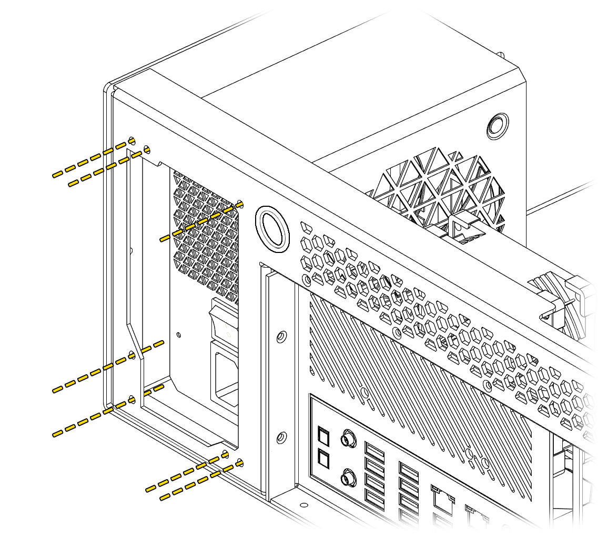
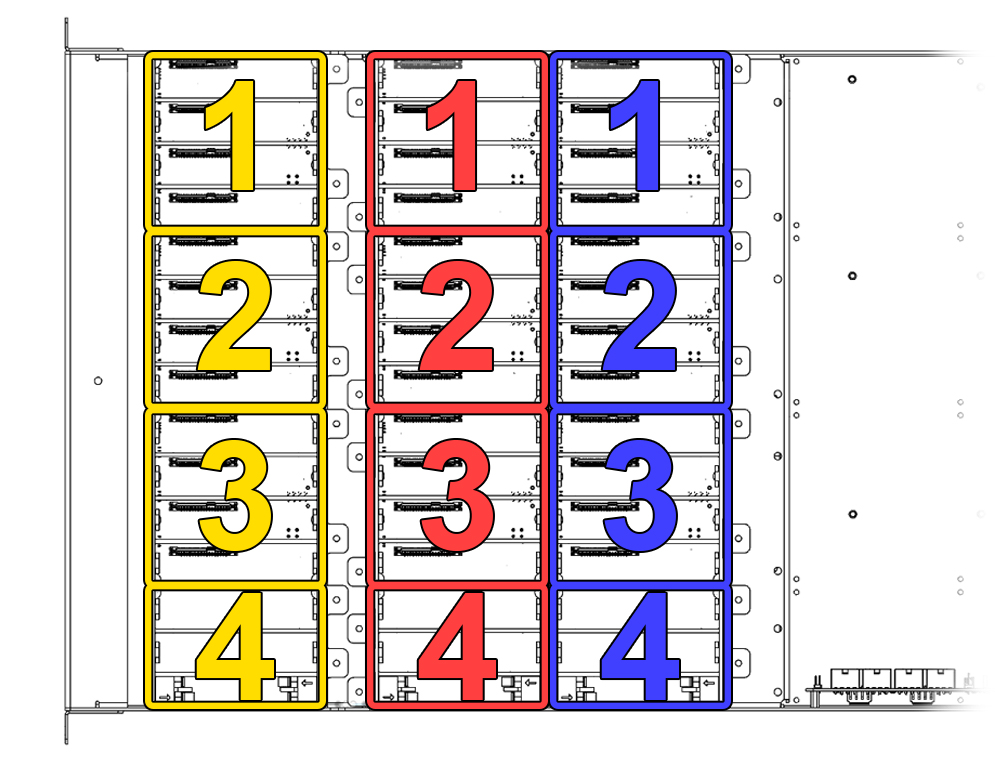

# Component Installation
## Motherboard

The Hako-Core supports motherboards from Mini-ITX up to SSI-EEB. See the [Specifications](specifications.md) page for the full list of supported form factors.
### Hako-Core Mini With E-ATX

The Hako-Core Mini when using an E-ATX motherboard limits the second row of backplane to only the small backplane

## Power Supply

Use the respective mounts for your specific power supply. The Hako-Core supports up to 200mm power supply.

## Mini-SAS Zip Tie Colors

The Mini-SAS cables have zip ties on them.  
Each color represents the row of backplanes it is connected to.  
The number of zip ties represent which backplane in that row it is connected to.

- Row 1: Yellow
- Row 2: Red
- Row 3: Blue

!!! info "Included SAS Cable Lengths"
    Pre-assembled chassis ship with the Mini-SAS cables preinstalled and sized per row: **Row 1 — 80cm, Row 2 — 60cm, Row 3 — 40cm**. The cables use SFF-8643 to SFF-8643 (Mini-SAS HD) connectors and are also sold separately in [40cm, 60cm, and 80cm lengths](https://hakoforge.com/collections/cables/products/sas-cable-8643-8643).