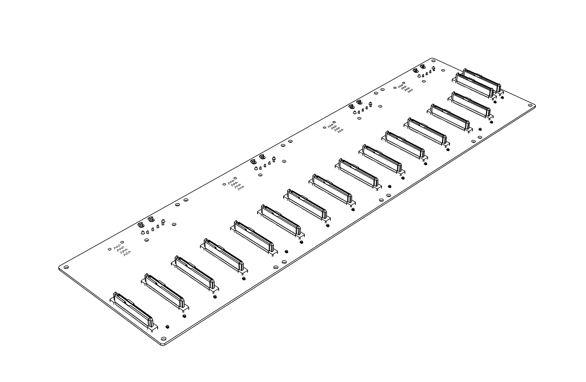
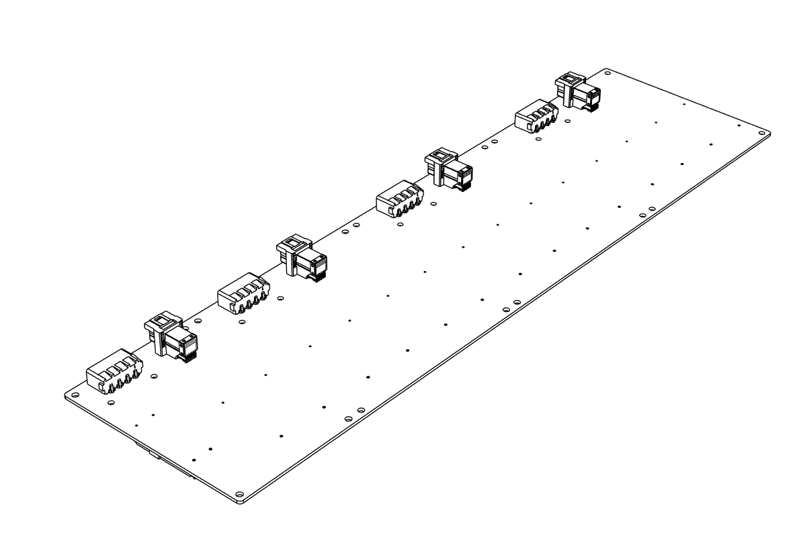
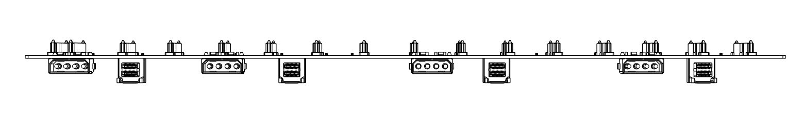
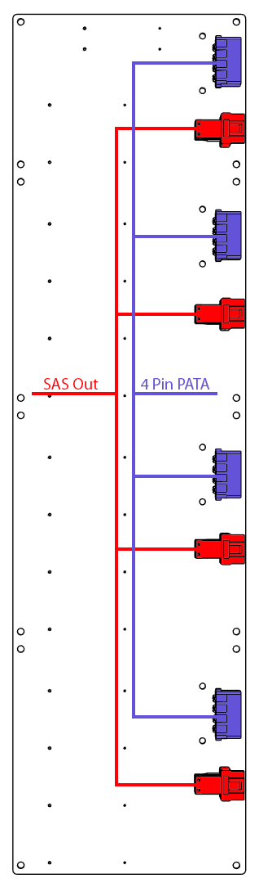
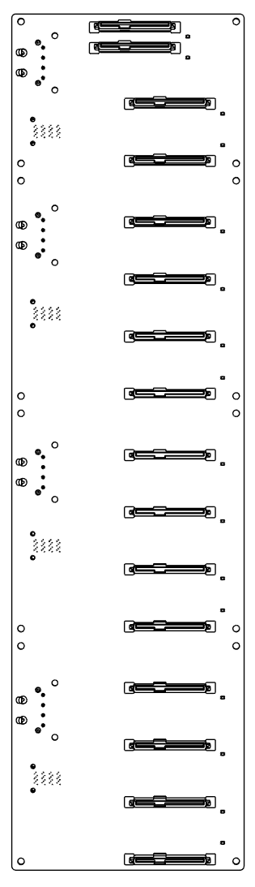

# HF-L1 Backplane

## Overview

<!-- TODO: fill in the backplane overview -->
The HF-L1 ships with 1 preinstalled backplane that provides power and data connectivity for the chassis drive bays. It is powered directly from the PSU via 4 PATA power cables (no power board required).

### Key Features

<!-- TODO: confirm / fill in the key features -->
- Supports 14 &times; 3.5" + 2 &times; 2.5" drives, or 16 &times; 2.5" drives
- Powered directly from the PSU via 4 PATA power cables
- SAS connectivity for data
- Hot-swap capable

## Technical Specifications

| Parameter | Specification |
|-----------|---------------|
| **Drive Connectors** | 16 (14 &times; 3.5" + 2 &times; 2.5") |
| **Drive Support** | 14 &times; 3.5" + 2 &times; 2.5", or 16 &times; 2.5" |
| **SAS Output** | 4 SAS Out Connector |
| **Input Power** | 4 &times; PATA from PSU |
| **Hot-Swap** | Yes |

!!! info "Drive Spin-Up"
    The current revision does not use staggered spin-up or active inrush limiting; it relies on drives that support **Power-Up In Standby (PUIS)**. For a fully populated array of 3.5" drives, enabling PUIS is recommended so the drives don't all spin up the instant power is applied — drives such as the Seagate Exos series support it. If you use older drives that do not support PUIS, the backplane is still built with components rated to handle the high inrush current.

    The backplane powers only the **12V and 5V** rails — **pin 3 (3.3V / PWDIS) is not powered** — so drives that use the PWDIS feature spin up normally.

## Backplane Diagram

{: style="max-width: 700px; width: 100%;"}

{: style="display: inline-block; width: 48%; vertical-align: top;"}
{: style="display: inline-block; width: 48%; vertical-align: top;"}

### Status Indicators

- Power LED — green when drive is powered
- Activity LED — flashing during I/O operations

## Installation Guide

For Drive Cage Installation see [Cage Installation](../hardware/cage-installation.md).

!!! info "SAS Cables"
    Pre-assembled chassis ship with the SAS cable preinstalled. It uses SFF-8643 (Mini-SAS HD) connectors and is sold separately in [40cm, 60cm, and 80cm lengths](https://hakoforge.com/collections/cables/products/sas-cable-8643-8643).

## Drive Installation

<!-- TODO: confirm drive installation steps -->
1. Insert drives gently into the drive cages.
2. Gently press each drive down until firmly seated.
3. Verify with LED indicators after system power-on.
