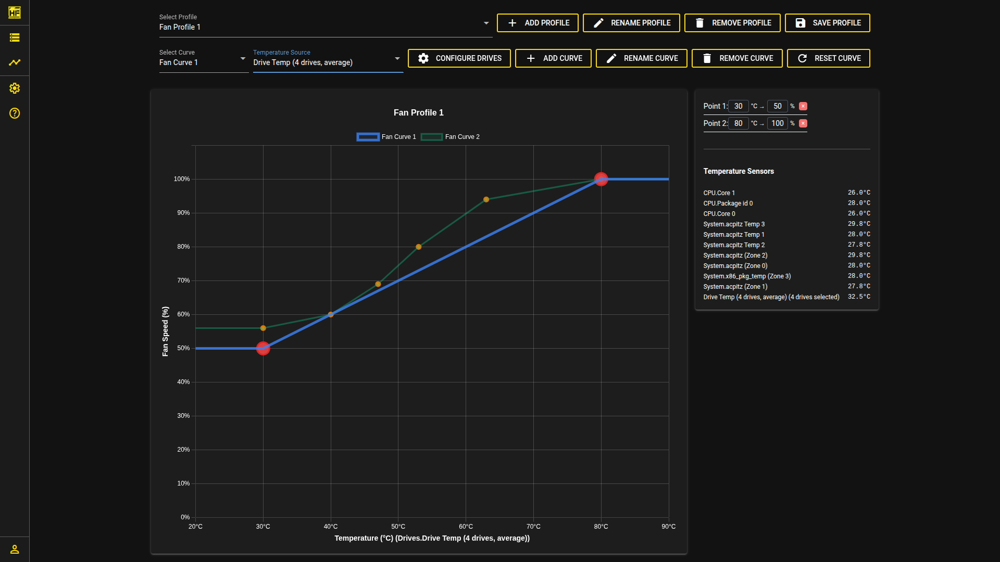
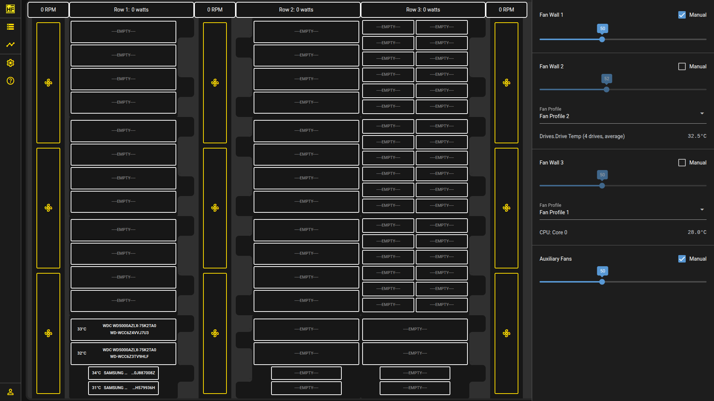

# Hako Foundry

HakoFoundry is our companion app — a Docker container (for example on TrueNAS Scale) that gives you a web dashboard for managing cooling and storage. With the [HakoForge power board](https://hakoforge.com/collections/pcbs/products/hakoforge-power-board) connected, it can:

- **Control the fans** — automatic fan curves that adjust speed based on CPU, motherboard, and drive temperatures, with each fan wall controllable individually.
- **Monitor drives** — view SMART data and drive temperatures in one place.
- **Monitor temperatures** — read system and drive sensors to drive the fan curves.

Without the power board it still runs as a monitoring tool. HakoFoundry is in active beta — see the [GitHub repository](https://github.com/HakoForge/HakoFoundry) for setup and full details.

!!! note "Optional Power Board"
    The HF-L1 does not need a power board. A [power board](https://hakoforge.com/collections/pcbs/products/hakoforge-power-board) is optional, and is only required if you want PWM fan control and HakoFoundry.