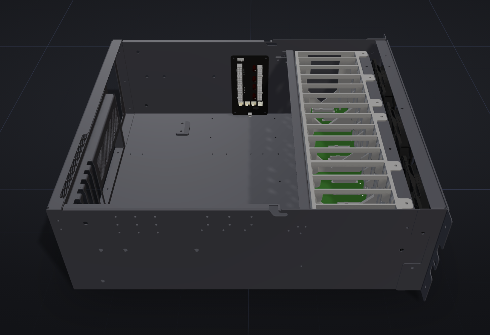
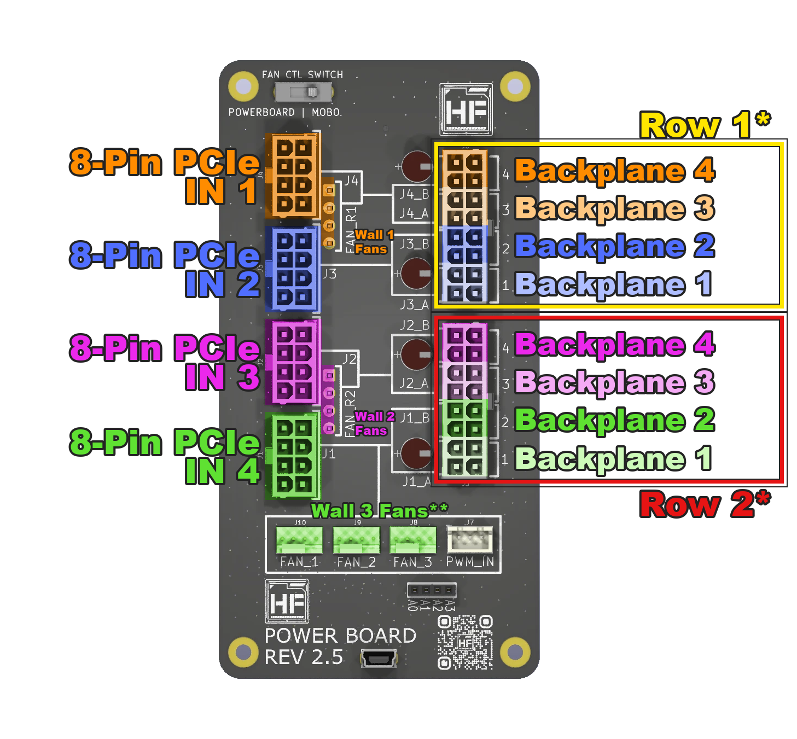
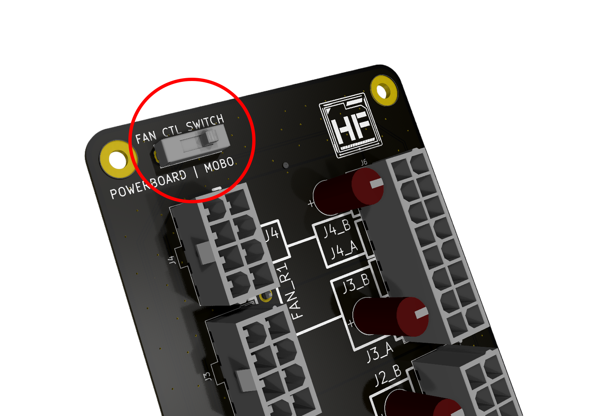
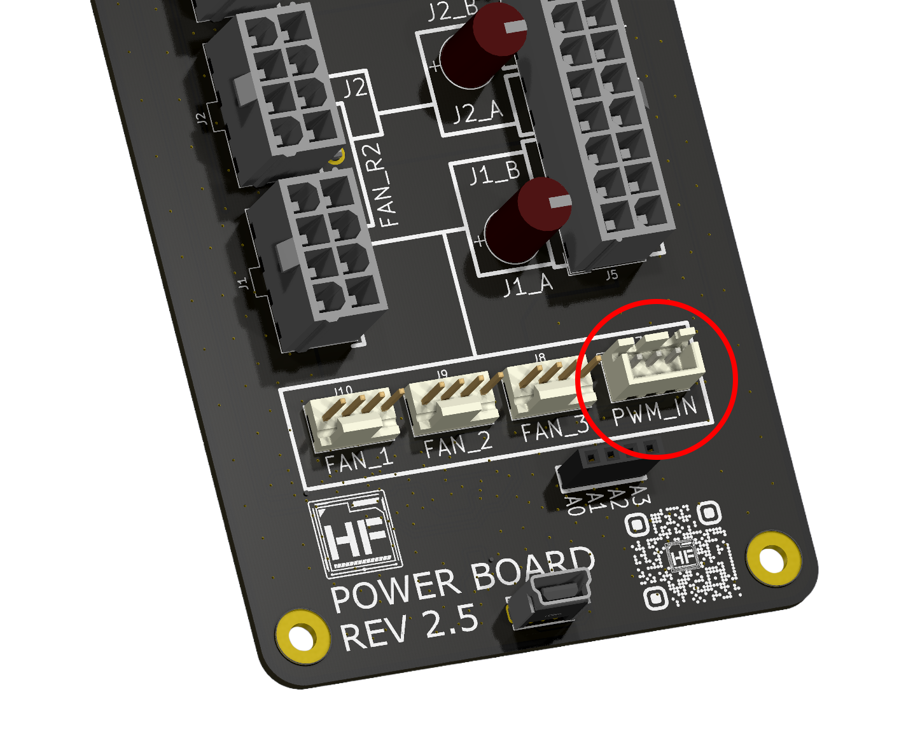
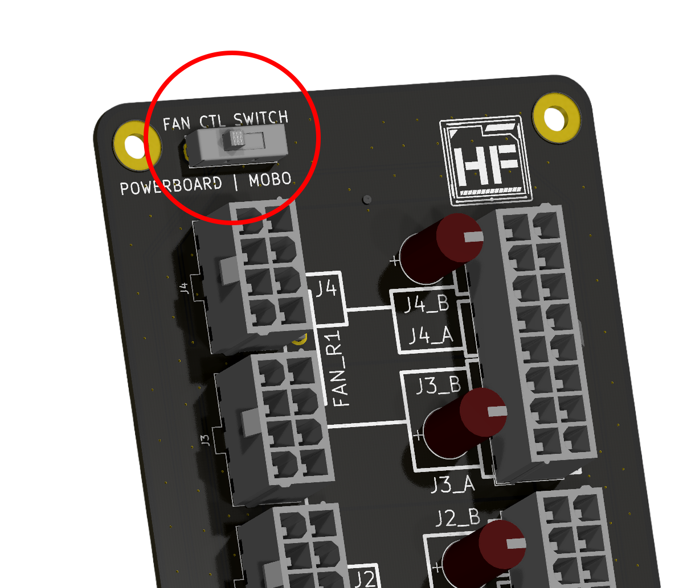
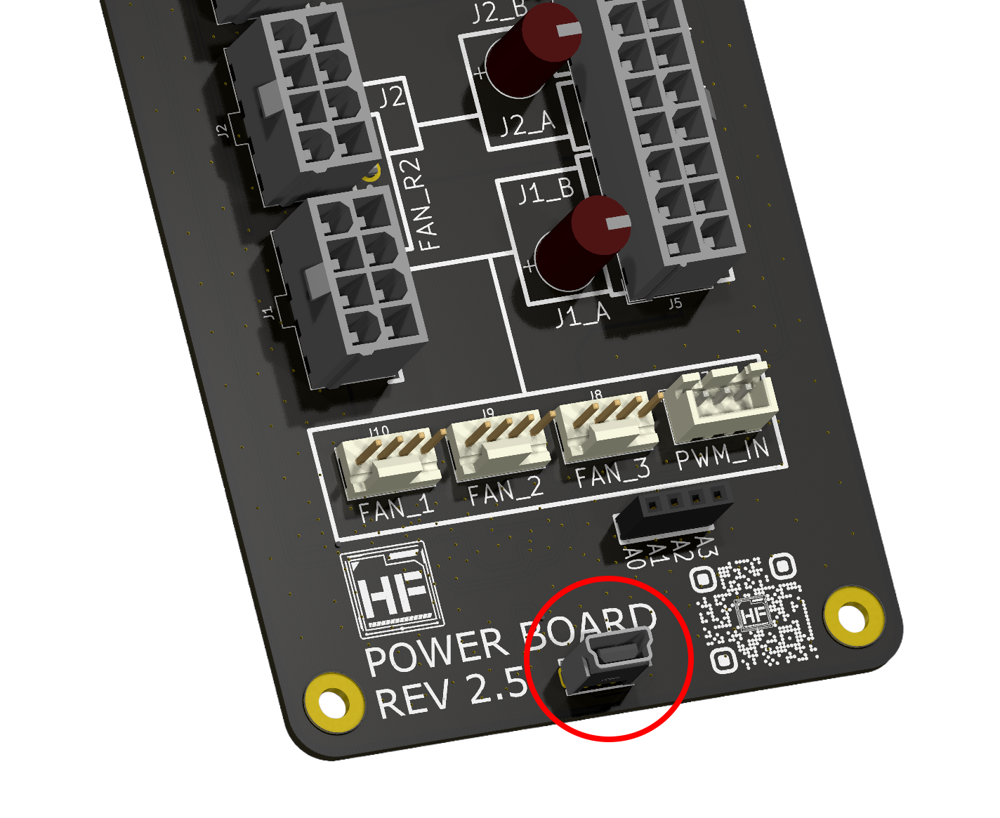

# Power Board Connections

The HF-L1 **does not need a power board** — the backplane is powered directly from the PSU. The optional [power board](https://hakoforge.com/collections/pcbs/products/hakoforge-power-board) is the **same board used across the HakoForge lineup**, and on the HF-L1 it is used **strictly for PWM fan control and [HakoFoundry](../foundry.md)**. It does not power the HF-L1 backplane.

## Installation

The power board mounts onto **4 standoffs** in the designated location inside the chassis, secured with the 4 provided screws.

{: style="max-width: 700px; width: 100%;"}

1. Ensure the board is correctly oriented.
2. Mount the power board onto the 4 standoffs with the provided screws.

## Powering the Board

The power board is powered by a spare **PCIe 8-pin** cable from the PSU. Connect it to **8-Pin PCIe IN 1**, which powers the fan outputs. Make sure your PSU has a spare PCIe 8-pin available if you plan to add the board.

## Power Distribution Map

{: style="max-width: 600px; width: 100%;"}

!!! note "HF-L1 Usage"
    On the HF-L1 only the **fan outputs (FAN_1–FAN_3), PWM_IN, USB, and the control switch** are used. The 8-pin backplane power outputs shown on the diagram are **not** connected — the HF-L1 backplane is powered directly from the PSU.

## Fan Control Switch

The power board has a fan control **switch** that selects whether the fans are controlled by the **motherboard** or by the **power board**.

### MOBO Position

All fan headers are controlled by the **PWM_IN** connector. Connect it to a motherboard fan header or a dedicated fan controller. The USB connection is not required.

### Power Board Position

All fan headers are controlled by the power board. A USB connection is required. With [HakoFoundry](../foundry.md) you can control each fan wall individually.

!!! info "Fan Wall Control & RPM"
    Each fan wall is controlled as a group — all fans on a wall run at the same speed, not individually. Like any fan splitter, only one fan per wall reports RPM, so a failed fan in another position on that wall will not show up in HakoFoundry. Check the fans physically if you suspect a failure.

## USB 2.0 Header

The power board connects to a **free internal USB 2.0 (9-pin) header** on your motherboard using the included Mini-B USB cable. This connection is required for individual fan wall control and drive power monitoring in HakoFoundry. If those features are not used, the USB connection is optional.

!!! warning "USB 2.0 Header Connector Orientation"
    Note the empty pin on the connector and align it with the motherboard correctly. Improper connection may damage components.

!!! note "Newer Motherboards"
    Some newer motherboards no longer include an internal 9-pin USB 2.0 header. In that case an adapter may be required.

## PWM_IN to Fan Header

The power board includes a PWM_IN to fan-header cable that connects to a motherboard fan header. That header then controls all fans connected to the power board. Leaving it unplugged runs the fans at full speed.
