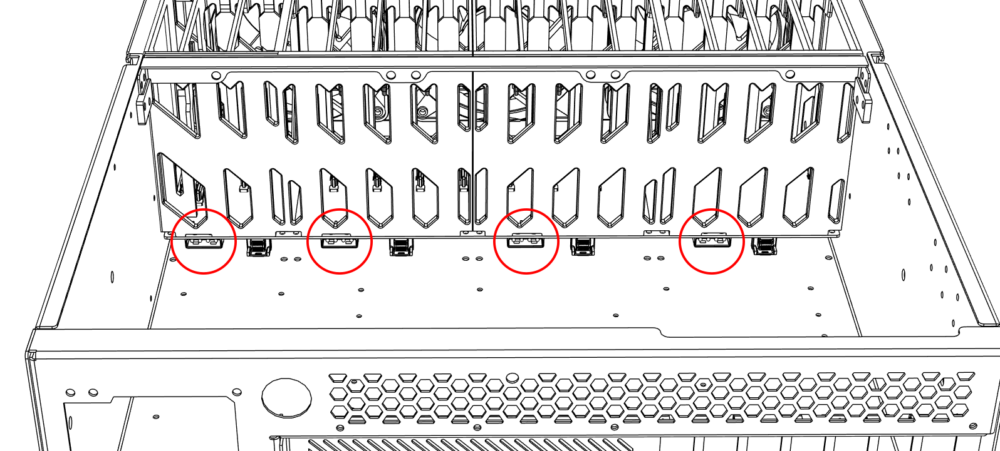

# Power

This chassis does not require a power board like our Core and Mini line of products. Instead, it is powered by **4 PATA connectors** run directly from the PSU to the backplane at the indicated areas below. 2 extension cables are included with purchase to help you.

{: style="max-width: 700px; width: 100%;"}

## Wiring

!!! tip "Recommended Wiring"
    Use **2 separate cables with 2 connectors on each** to power the backplane.

A single cable with 4 connectors can also be used, as long as the wiring is **16AWG**.

!!! warning "Avoid SATA-to-PATA Adapters"
    Using a SATA-to-PATA adapter is **not recommended**.

!!! note "Optional Power Board"
    A power board can be purchased separately for PWM fan control and usage of [HakoFoundry](foundry.md).
